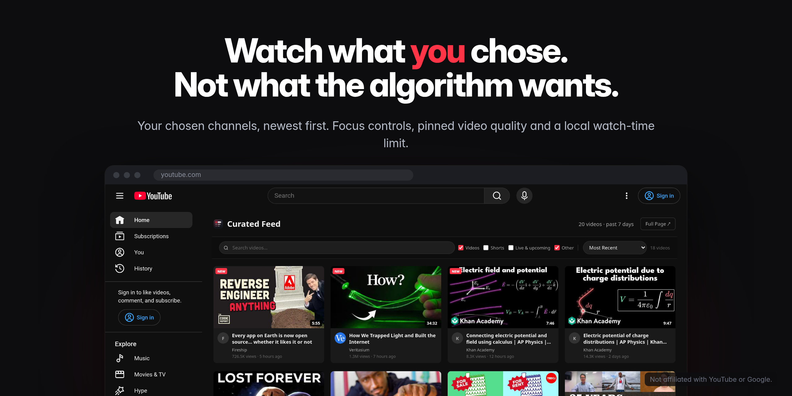
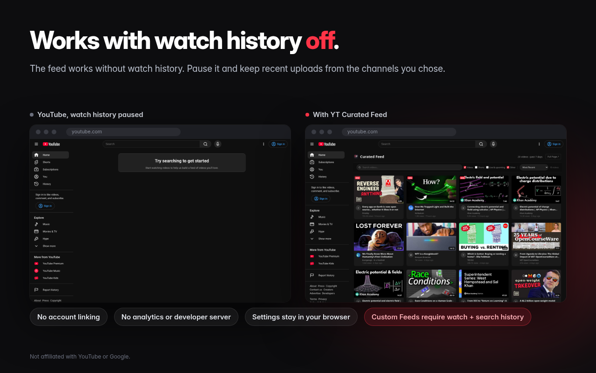
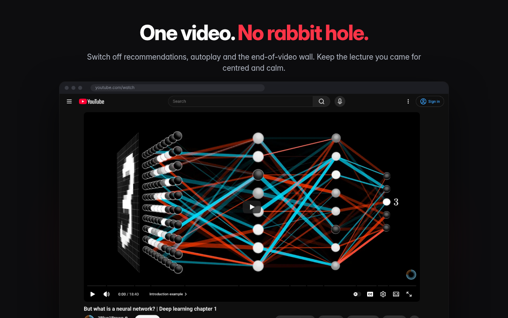
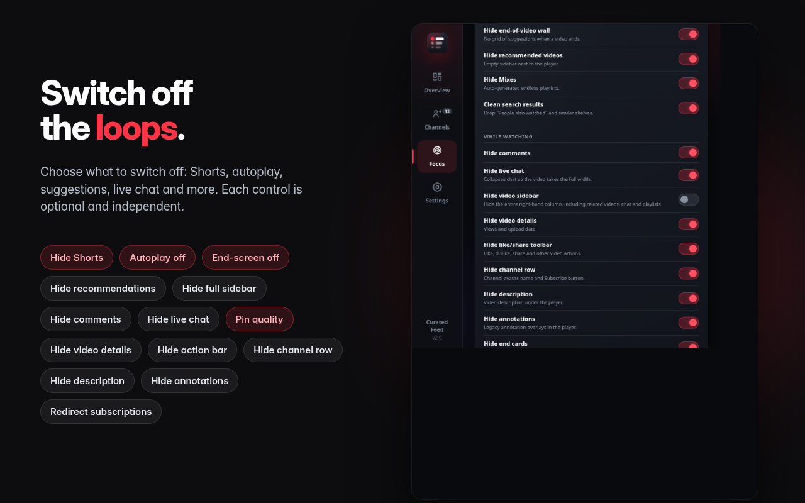
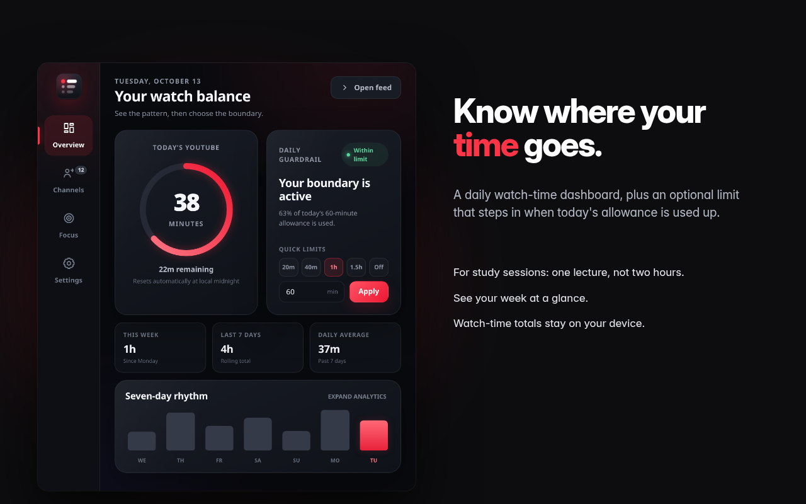

<p align="center">
  
</p>

<h1 align="center">YT Curated Feed</h1>

<p align="center">
  <b>Your YouTube homepage. Only the channels you chose.</b><br />
  Get the video you came for. Break the endless-scroll loop.
</p>

<p align="center">
  <a href="LICENSE"></a>
  
  
  
  
</p>

<p align="center">
  
</p>

You open YouTube for one lecture. Autoplay offers another video. The sidebar offers ten more. Shorts turn a five-minute break into an hour—and the reason you opened YouTube gets lost.

**YT Curated Feed flips the default.** The Home page becomes a channel-first feed of recent uploads from sources you explicitly selected, newest first. Then you choose which distractions to remove. Less time being pulled around; more control over what you came to watch.

## Built for focused viewing

- **Students and learners:** go straight to your lectures, course channels and explainers instead of wandering through recommendations.
- **Anyone fighting procrastination:** interrupt the “one more video” loop by removing the prompts that keep it going.
- **People who want control back:** see what your chosen channels uploaded, in order, without a recommendation engine deciding which sources enter this feed.

## What you get

| | |
|---|---|
| **A homepage with boundaries** | The default full-page mode replaces YouTube's recommended Home grid with uploads from your selected channels from the last seven days, newest first. Import subscriptions in one click or add any channel by `@handle`. Prefer the original Home grid? Switch to the optional compact panel. |
| **Works with watch history paused** | The curated feed does not depend on your watch history. Pausing history may remove YouTube's own Home recommendations, while your channel feed continues to work. This limits one source of personalization; it does not disable every form of Google or YouTube data processing. |
| **Individual focus controls** | Hide Shorts (their links open in the regular player), disable autoplay, remove the end-screen suggestion wall, hide the entire video sidebar or only related videos, comments, live chat, video details, the action bar, channel row, description, annotations, end cards, Mixes, search shelves, playlist panel, merch, offers and fundraisers. You can also hide Explore/Trending, the top header, notification bell, “More from YouTube,” and hide/redirect the Subscriptions page. Live chat is collapsed through YouTube's own handler so the player can reclaim its width. |
| **Pin video quality** | Choose Auto, 144p, 240p, 360p, 480p, 720p, 1080p, 1440p or 4K. The extension picks the closest available level, and you can still change quality manually in the player. |
| **A local watch-time dashboard** | See today's total, your weekly pattern and the last seven days. Set an optional daily limit that steps in when you reach it. Your totals stay in local browser storage. |
| **Fast, resilient feeds** | In the developer's tests, a cold feed of around 50 channels loaded in about 4–5 seconds; a cached refresh was under one second. Actual speeds depend on YouTube and your connection. If RSS fails for a channel, the extension can fall back to YouTube's own InnerTube endpoint. |
| **No developer backend** | No account linking to this extension, OAuth, API keys, analytics or developer server. Your settings and watch-time totals are stored locally. Requests for public channel/video data go to YouTube and its thumbnail host, without your YouTube cookies. |

<p align="center">
  
  
  
  
</p>

## YouTube Custom Feeds vs. a feed you control

YouTube's Custom Feeds let you describe a mood, routine or topic and generate a dedicated, refreshing feed. That can be useful for discovery—but it remains a prompt-led experience shaped by YouTube. **YT Curated Feed lets you choose the channels yourself.** Its feed is built from their recent uploads, not from your prompt.

| | YouTube Custom Feeds | YT Curated Feed |
|---|---|---|
| What you choose | A prompt that shapes a dedicated feed | The specific channels allowed into your feed |
| Watch/search history | Requires watch and search history enabled | Works with watch history paused |
| Availability | YouTube's experiment is rolling out to signed-in US viewers in English | Install in a supported Chromium browser |
| Focus controls | YouTube's viewing experience | Independent controls for Shorts, autoplay, live chat, related videos and more |

YouTube's [official Custom Feeds announcement](https://support.google.com/youtube/blog/436892232/introducing-a-new-discovery-experience-designed-by-you?hl=en) says the experiment currently requires watch and search history to be on and is rolling out to signed-in viewers in the US in English. Rollout details can change, so check the announcement for current eligibility.

## Install

**Load the ready-to-use source tree:**

1. Download the repository with `Code → Download ZIP` or choose a [release](https://github.com/giri256/yt-curated-feed/releases).
2. Open `chrome://extensions` in Chrome, Brave, Edge or another supported Chromium browser (version 111+).
3. Turn on **Developer mode**.
4. Click **Load unpacked** and select the folder that contains `manifest.json`.

No build step and no `npm install` are needed to load the source tree.

## Get started

1. Click the extension icon → **Channels** → **Load my subscriptions**, or add a channel by `@handle`.
2. Select the channels you actually want and save.
3. Open YouTube. By default, your curated feed replaces the Home grid.
4. Open **Focus** in the popup to choose what to hide, pin video quality, or switch to **Compact** to keep YouTube's own grid below the smaller feed panel.

For the cleanest homepage, you can pause your watch history at [youtube.com/feed/history](https://www.youtube.com/feed/history). The curated feed continues to work without it. Pausing history does not disable every other kind of data processing by Google or YouTube.

## Built in the open

- **MIT licensed.** Use, inspect, fork and contribute under the terms in [LICENSE](LICENSE).
- **Zero runtime dependencies.** Plain JavaScript, HTML and CSS—no framework or bundled third-party code. `build.mjs` copies the source into `dist/`.
- **Readable and auditable.** See [`docs/ARCHITECTURE.md`](docs/ARCHITECTURE.md) and [`PROJECT_UNDERSTANDING.md`](PROJECT_UNDERSTANDING.md).
- **No developer backend.** The extension fetches public channel feeds, video details and thumbnails; it does not send preferences or watch-time totals to a developer server.
- **Tested.** Node's built-in test runner covers feed and focus behavior. An optional headless Brave smoke test checks the live YouTube endpoints.

### Permissions

| Permission | Why |
|---|---|
| `storage` | Stores selected channels, preferences and watch-time totals locally |
| `tabs` | Opens the subscriptions page for import and the feed page |
| `declarativeNetRequestWithHostAccess` | Sets the `Origin: https://www.youtube.com` header on the extension's own InnerTube requests |
| YouTube host access | Runs the curated homepage/focus controls, fetches channel/video data and loads channel avatars |

## Development

```bash
npm test
npm run build
BRAVE_EXECUTABLE_PATH=/usr/bin/brave npm run smoke:browser
```

Key files:

```
manifest.json          MV3 extension manifest
src/background.js      feed fetching, cache, storage, messages
src/content.js/.css    full-page homepage takeover or compact panel
src/focus.js/.css      focus preferences, hide rules and Subscriptions redirect
src/page-main.js       live-chat collapse, autoplay and pinned video quality
src/watch-tracker.js   local watch-time accounting and daily-limit overlay
src/popup.*            dashboard, channels, focus controls, settings and support
src/welcome.html       first-run guide and support links
tests/                 automated regression tests
scripts/brave-smoke.mjs live YouTube/service-worker smoke test
```

Contributions are welcome. Please open an issue before larger changes and run `npm test` before submitting a pull request.

## Keep it free

YT Curated Feed is free, with no ads, no premium tier and no data selling. If it helps you reclaim an evening, optional support keeps development going:

- ☕ [Buy me a coffee](https://buymeacoffee.com/giri256)
- 💳 [Donate with PayPal](https://paypal.me/kgspavan)
- ⭐ [Star the repository](https://github.com/giri256/yt-curated-feed)

## Credits and license

- MIT licensed; see [LICENSE](LICENSE).
- The video-quality pin adapts the public-player-API approach used by [YouTube Enhancer](https://github.com/YouTube-Enhancer/extension) (MIT); see the in-code credit.
- YT Curated Feed is independent and is not affiliated with, endorsed by or sponsored by YouTube or Google. YouTube is a trademark of Google LLC.
